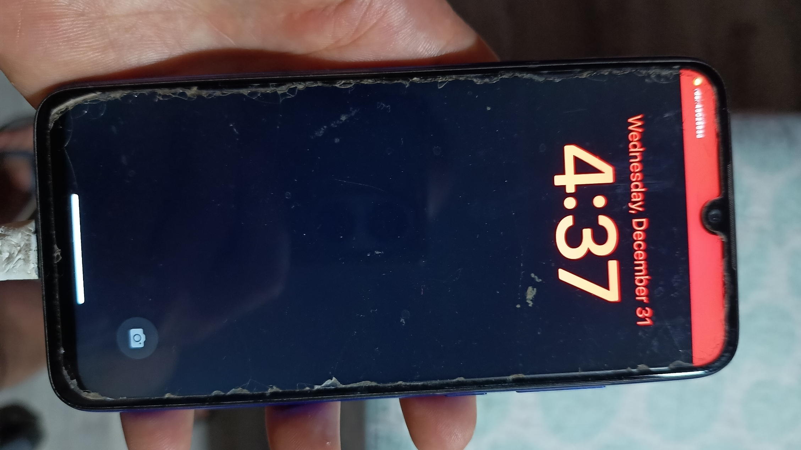

# iOS 16 en el Redmi Note 7 (lavender)

Port de investigación, no comercial, de **XNU 8796** (Darwin 22 / iOS 16) y del userland de **iPhone X (D22AP) iOS 16.7.16** al **Redmi Note 7** (`lavender`, Qualcomm SDM660 / Snapdragon 660).



> **Estado: arranca hasta el lock screen de iOS 16.7.16.** Es un bring-up experimental, no un teléfono de uso diario. Los botones físicos y la red USB (CDC-NCM: ping y log del kernel en vivo desde Windows) funcionan en el teléfono. Touch, aceleración GPU, Wi-Fi, audio y batería todavía no funcionan. En este repositorio no se distribuyen binarios de Apple.

El port se apoya en [`aLpHa-Git-69/ios-lavender`](https://github.com/aLpHa-Git-69/ios-lavender) (rama `lavender`), derivado de [`dipa-studio/ios-sweet`](https://github.com/dipa-studio/ios-sweet). Acá está la bitácora del bring-up de lavender, los parches que hicieron confiable la escritura eMMC y el estado real del dispositivo.

## Qué anda

| Área | Estado | Notas |
| --- | --- | --- |
| Arranque XNU | **Anda** | `xnu-8796`, kernel `LAVENDER` Mach-O arm64 |
| CPU | **Anda** | 4× Cortex-A73 Gold con páginas de 16 KiB; los A53 Silver quedan aparcados |
| GICv3 / timers | **Anda** | GIC y timers virtual/físico |
| eMMC SDCC v5 | **Anda** | Enumeración, raíz HFSX, journal replay, lecturas y escrituras; el anillo de log se vuelca |
| Raíz HFSX en `userdata` | **Anda** | `rd=emmcroot0`, read-write; sin dual-boot con Android |
| Framebuffer / AppleCLCD | **Anda** | 1080×2340, stride 4320, composición por software con IOSurface |
| `launchd` / daemons | **Anda** | `launchd`, `backboardd`, `SpringBoard`, `securityd`, `keybagd`, `usermanagerd`, etc. |
| GUI de iOS | **Anda** | Logo de Apple, barra de progreso y lock screen de iOS 16 |
| Code signing de bring-up | **Anda** | `cs_enforcement_disable=1`, `unentitled_ios_sim_launch=1`, `launchd_unsecure_cache=1` |
| Log persistente | **Anda** | Anillo `SANTONILOG1` de 4 MiB en SYSTEM |
| 4 Gold cores | **Anda** | `cpus=4`; `SWEET CPU: requested=4 selected=4` |
| Orientación del panel | **Anda** | El lock screen se ve vertical y derecho, ocupando el panel 1080×2340 (`docs/images/lock-screen.jpg`) |
| Botones físicos | **Anda** | Parche `0201`: Power/Vol+/Vol− por el árbitro SPMI v3 de SDM660, llegan al HID de iOS |
| Red USB | **Anda** | Parches `0200`, `0210`–`0213`: DWC3 + QUSB2, CDC-NCM (UsbNcm de Windows, macOS, Linux), `ping 192.168.7.2`, log del kernel en vivo por UDP 5140 (`sweetusb=2`; `tools/usbnet-windows.ps1`). SSH root por el enlace (dropbear, `docs/SSH.md`) |
| Touch | **Anda (lento)** | Novatek NT36672A en QUP1 I2C (bit-bang): parches `0193`–`0208`, `0230`. Taps y swipes llegan a iOS: setup, home screen e íconos responden. Cada lectura tarda ~14 ms (12 bytes) a ~65 ms (frame completo): ver ROADMAP |

## Qué falta

| Área | Estado | Notas |
| --- | --- | --- |
| GPU | **Falta** | Adreno 512 sin driver; `IOAcceleratorES` vacío evita la espera de QuartzCore, render por software |
| Cámara | **Falta** | Botón y stack de cámara sin implementar |
| Wi-Fi / Bluetooth | **Falta** | Sin firmware/driver Wi-Fi; `bluetoothd` respawnea sin hardware |
| Audio | **Falta** | Sin driver de codec |
| Batería / carga | **Parcial** | Fallback estático (100 %, 4200 mV); sin gauge |
| Colores del lock screen | **A verificar** | En la foto, fecha, hora y barra de estado salen rojas/anaranjadas: tinte del wallpaper o formato de color del framebuffer, sin revisar |
| RTC / fecha | **Parcial** | El parche `0220` lee el RTC del PM660. Su cuenta cruda no es hora Unix (Android guarda su propio offset): cada teléfono necesita `sweetrtcoff=` medido una vez en TWRP (`docs/BOOT.md`); sin eso el calendario arranca en la hora de compilación del shim (`sweetrtc`). Falta ver el lock screen con la fecha real |
| `preboot` / data volume | **Parcial** | `libignition` no encuentra el preboot; el boot sigue sin sellar |
| Segundo boot / tiempo de boot | **Parcial** | El segundo boot corre sin migración (el plist funciona), pero tarda ~18 min hasta el lock screen |

## Hitos

- **2026-11-19 — Fase 0.** ROM stock verificada, TWRP, backups de 15 particiones + GPT y runbook de restauración.
- **2026-11-19 — Primer boot XNU.** Kernel `LAVENDER` compilado en GitHub Actions; `launchd` murió con `CS_KILLED`.
- **2026-11-19 — Code signing.** Con los flags CS/RW arrancan `launchd`, `xpcproxy`, `cfprefsd`, `powerd`, `distnoted`, `watchdogd` y `SpringBoard`.
- **2026-11-19 — Escrituras eMMC.** El parche `0192` espera DAT0 + `TRAN`/`READY_FOR_DATA` por CMD13 después de cada write PIO. Antes, CMD24/CMD25 daban timeout y el anillo quedaba vacío; después, el anillo volcó 100+ KiB sin timeouts.
- **2026-11-19 — Cuatro Gold.** `cpus=4` levanta los cuatro A73; los A53 Silver siguen aparcados por las páginas de 16 KiB.
- **2026-11-19 — Migración inicial.** Una raíz nueva necesita una pasada larga de `DataMigration`. La imagen lleva `com.apple.DataMigration.plist` con `LastSystemVersion = 20H392` para que los siguientes boots la salten.
- **2026-11-19 — Lock screen de iOS 16.** El teléfono llegó al lock screen de iOS 16.7.16: `Wednesday, December 31`, `4:37`, acceso a cámara y home indicator. Ese es el estado actual.

## Cómo arranca

```
ABL de Xiaomi
  -> shim en la partición recovery (Power + Volumen ARRIBA)
  -> kernel XNU + ADT + boot args
  -> raíz HFSX desde userdata (rd=emmcroot0)
  -> launchd -> mount-phase-1/2 -> backboardd -> SpringBoard
  -> lock screen de iOS 16
```

El shim se flashea en `recovery`; `fastboot boot` está stubbeado en esta unidad. `fastboot reboot recovery` arranca Android y MIUI restaura el recovery stock, así que la secuencia que funciona es: flashear el shim, apagar y encender con **Power + Volumen ARRIBA**.

Los boot args actuales incluyen:

```
rd=emmcroot0 emmcrw=1 rootrw=1
cs_enforcement_disable=1 unentitled_ios_sim_launch=1 launchd_unsecure_cache=1
sweetlog=1 sweetfb_noconsole=1 sweetfb_stayon=1 sweetfb_hz=30
wdt=-1 wdt_test=no_user_checkin cpus=4
```

Ver [`docs/BOOT.md`](docs/BOOT.md) para la cadena completa y cómo sacar el log.

## Build

El repositorio no contiene binarios de Apple, el IPSW, la imagen raíz de 16 GiB ni la ROM stock. Hay que aportarlos.

1. **Kernel** — forkear `aLpHa-Git-69/ios-lavender`, pushear a `lavender` y dejar que `.github/workflows/xnu.yml` compile `kernel.development.lavender` en `macos-15`.
2. **Shim** — `BOARD=lavender shim/build.sh <kernel>` dentro del árbol base; empaqueta kernel, ADT y boot args en un boot image Android.
3. **Imagen raíz** — extraer `OS.dmg`, `SystemOS.dmg` y `AppOS.dmg` del IPSW de iPhone X 16.7.16 y construir la HFSX con `bergamota/tools/mkiosroot-macos.sh` + `sweet-root-tweaks.py`.
4. **Flash** — `fastboot -S 512M flash userdata ios16-root.simg`, después `fastboot flash recovery shim-boot.img` y Power + Volumen ARRIBA.

Los comandos, hashes y advertencias están en [`docs/BUILD.md`](docs/BUILD.md).

## Créditos y legal

- [`aLpHa-Git-69/ios-lavender`](https://github.com/aLpHa-Git-69/ios-lavender): árbol XNU lavender/whyred, driver eMMC, shim y notas.
- [`dipa-studio/ios-sweet`](https://github.com/dipa-studio/ios-sweet): tooling y metodología.
- [`ry-diffusion/bergamota`](https://github.com/ry-diffusion/bergamota): `mkiosroot-macos.sh` y shim.
- [`MakrSas/ios-topaz`](https://github.com/MakrSas/ios-topaz): referencia A73/A53, Wi-Fi y GPU.
- [`oosexgang/hakios-xnu-kernel`](https://github.com/oosexgang/hakios-xnu-kernel): metodología.

XNU es open source (APSL); el userland de iOS, el IPSW y los binarios de Apple **no** se distribuyen acá. Es investigación; no usar con datos personales ni Apple ID. Ver [`docs/LEGAL.md`](docs/LEGAL.md).
