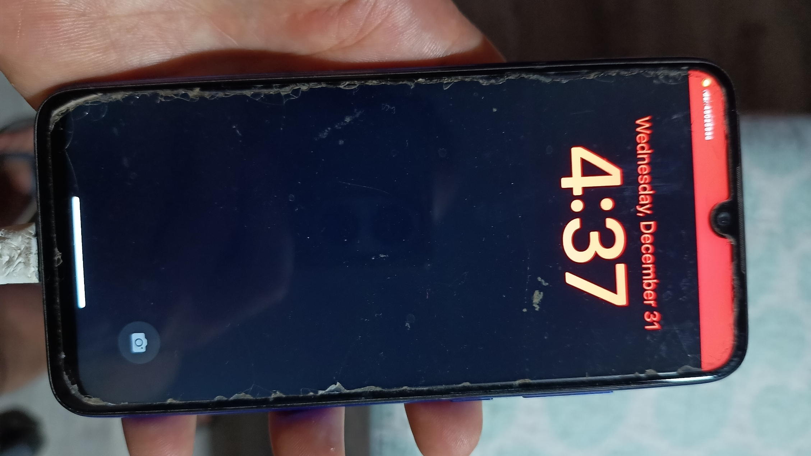

# iOS 16 on the Redmi Note 7 (lavender)

A non-commercial research port of **XNU 8796** (Darwin 22 / iOS 16) and the **iPhone X (D22AP) iOS 16.7.16 userland** to the **Redmi Note 7** (`lavender`, Qualcomm SDM660 / Snapdragon 660).



> **Status: boots to the iOS 16.7.16 lock screen.** This is an experimental bring-up, not a daily driver. Physical buttons and USB networking (CDC-NCM: ping and a live kernel log from Windows) work on the device. Touch, GPU acceleration, Wi-Fi, audio and battery are not working yet. No Apple binaries are distributed in this repository.

The port is built on top of [`aLpHa-Git-69/ios-lavender`](https://github.com/aLpHa-Git-69/ios-lavender) (branch `lavender`), itself derived from [`dipa-studio/ios-sweet`](https://github.com/dipa-studio/ios-sweet). This repository documents the lavender-specific bring-up, the patches that made eMMC writes reliable, and the current state of the device.

## What works

| Area | Status | Evidence / notes |
| --- | --- | --- |
| XNU boot | **Works** | `xnu-8796`, `kernel.development.lavender`, Mach-O arm64 |
| CPU bring-up | **Works** | 4× Cortex-A73 Gold, 16 KiB pages; Silver A53 cores parked (they do not support 16 KiB) |
| GICv3 / timers | **Works** | GIC 0x17a00000/0x17b00000, virtual/physical timers |
| eMMC (SDCC v5) | **Works** | Enumeration, HFSX root, journal replay, reads and writes; log ring flushes |
| HFSX root in `userdata` | **Works** | `rd=emmcroot0`, read-write; no Android dual boot |
| Framebuffer / AppleCLCD | **Works** | 1080×2340, stride 4320, software composition via IOSurface |
| `launchd` / daemons | **Works** | `launchd`, `backboardd`, `SpringBoard`, `securityd`, `keybagd`, `usermanagerd`, etc. |
| iOS GUI | **Works** | Apple logo, progress bar and the iOS 16 lock screen |
| Code signing bring-up | **Works** | `cs_enforcement_disable=1`, `unentitled_ios_sim_launch=1`, `launchd_unsecure_cache=1` |
| Persistent kernel log | **Works** | 4 MiB `SANTONILOG1` ring on the SYSTEM partition |
| 4 Gold cores | **Works** | `cpus=4`; `SWEET CPU: requested=4 selected=4` |
| Panel orientation | **Works** | The lock screen is portrait and upright, filling the 1080×2340 panel (`docs/images/lock-screen.jpg`) |
| Physical buttons | **Works** | Patch `0201`: Power/Volume Up/Volume Down through the SDM660 SPMI arbiter v3, delivered to iOS HID |
| USB network | **Works** | Patches `0200`, `0210`–`0213`: DWC3 + QUSB2 bring-up, CDC-NCM (Windows UsbNcm, macOS, Linux), `ping 192.168.7.2`, live kernel log on UDP 5140 (`sweetusb=2`; `tools/usbnet-windows.ps1`) |

## What does not work yet

| Area | Status | Notes |
| --- | --- | --- |
| Touch | **In progress** | Novatek on QUP1 I2C (`0x62`): patches `0193`–`0199`, `0203` (probe, NT36772 firmware boot, xdata, HID thread); not usable yet |
| GPU acceleration | **Missing** | Adreno 512 has no driver; an empty `IOAcceleratorES` keeps QuartzCore from waiting, rendering is software |
| Camera | **Missing** | Camera button and camera stack are not implemented |
| Wi-Fi / Bluetooth | **Missing** | No Wi-Fi firmware/driver; `bluetoothd` respawns without hardware |
| Audio | **Missing** | No audio codec driver |
| Battery / charging UI | **Partial** | Static battery fallback (`100%`, 4200 mV); no gauge driver |
| Lock screen colours | **To verify** | The date, clock and status bar render red/orange on the lock screen photo: wallpaper tint or a framebuffer colour-format issue, not checked yet |
| RTC / date | **Partial** | Patch `0220` reads the PM660 RTC. Its raw count is not Unix time (Android keeps its own offset), so each phone needs `sweetrtcoff=` measured once in TWRP (`docs/BOOT.md`); without it the calendar starts at the shim build time (`sweetrtc`). Lock screen with the real date not checked yet |
| `preboot` / data volume | **Partial** | `libignition` cannot find the preboot volume; the boot continues unsealed |
| Second boot / boot time | **Partial** | The second boot runs without the data migration (the `DataMigration` plist works), but still takes ~18 min to the lock screen |

## Milestones

- **2026-11-19 — Phase 0 safety net.** Verified stock fastboot ROM, TWRP, 15 partition backups + GPT, and a complete restore path.
- **2026-11-19 — First XNU boot.** Kernel built for `LAVENDER` in GitHub Actions; the first boot reached `launchd` but died with `CS_KILLED`.
- **2026-11-19 — Code-signing bring-up.** The CS/RW boot arguments let `launchd`, `xpcproxy`, `cfprefsd`, `powerd`, `distnoted`, `watchdogd` and `SpringBoard` run.
- **2026-11-19 — eMMC writes fixed.** Patch `0192` waits for DAT0 + `TRAN`/`READY_FOR_DATA` (CMD13) after every PIO write. Before it, CMD24/CMD25 timed out and the log ring stayed empty; after it, the ring flushed 100+ KiB with zero write timeouts.
- **2026-11-19 — Four Gold cores.** `cpus=4` brings up all four A73 cores; the A53 Silver cores stay parked because they cannot run 16 KiB pages.
- **2026-11-19 — First-boot data migration.** A fresh root image needs one long `DataMigration` pass. The image now carries `com.apple.DataMigration.plist` with `LastSystemVersion = 20H392`, so subsequent boots should skip it.
- **2026-11-19 — iOS 16 lock screen.** The device reached the iOS 16.7.16 lock screen: `Wednesday, December 31`, `4:37`, the camera shortcut and the home indicator are visible. This is the current state.
- **2026-11-20 — USB and button drivers (host-tested).** `sweet_usb.c` and `sweet_keys.c` were compiled for lavender but never called (their only caller is the UFS path), and they used other SoCs' addresses. Patches `0200`/`0201` port them to SDM660 with addresses from the phone's DTB and start them on lavender. On the device the keys worked at once; USB needed three more fixes found with ~1-minute `sweetusbhold` boots: `0210` powers the QUSB2 PHY ABL leaves off, `0211` brings the DWC3 core up as Linux does, `0212` releases the PHY's UTMI test mux.
- **2026-11-20 — 30 s off every boot.** Every boot stopped for exactly 30.000 s while XNU waited for an `IORTC` resource nothing publishes; that wait is also why the calendar started at 1970. `0220` skips it (as XNU does for BCM2837) and reads the PM660 RTC: eMMC and USB now come up at ~16 s instead of ~46 s.
- **2026-11-20 — USB network on Windows.** `0213` turns the gadget into CDC-NCM: Windows 11 binds its in-box UsbNcm driver, `ping 192.168.7.2` answers (70/70, 1400-byte frames) and the kernel console streams live to the PC. No more TWRP round-trips to read a log.

## Hardware

| | Redmi Note 7 (`lavender`) |
| --- | --- |
| SoC | Qualcomm SDM660 / Snapdragon 660 |
| CPU | 4× Cortex-A73 Gold + 4× Cortex-A53 Silver |
| Page size | 16 KiB on Gold only; Silver parked |
| RAM / storage | 4 GB / 64 GB eMMC 5.1 |
| eMMC controller | Qualcomm SDCC v5 at `0x0c0c4000`, GIC SPI 110 |
| Display | 1080×2340, stride 4320, framebuffer `0x9d400000` |
| Touch | Novatek NT36672 (QUP1 I2C, `0x62`); Synaptics is the alternative panel |
| PMIC | PM660 / PM660L |
| GPU | Adreno 512 (no iOS driver) |
| Bootloader | Unlocked Xiaomi ABL; `fastboot boot` is stubbed on this unit |

See [`docs/HARDWARE.md`](docs/HARDWARE.md) for the full audit and constraints.

## How it boots

```
Xiaomi ABL
  -> shim in the recovery partition (Power + Volume Up)
  -> XNU kernel + ADT + boot arguments
  -> HFSX root from userdata (rd=emmcroot0)
  -> launchd -> mount-phase-1/2 -> backboardd -> SpringBoard
  -> iOS 16 lock screen
```

The shim is flashed to `recovery`; `fastboot boot` is stubbed by this ABL. `fastboot reboot recovery` boots Android and MIUI restores the stock recovery, so the working sequence is: flash the shim, power off, then **Power + Volume Up**.

The current boot arguments include:

```
rd=emmcroot0 emmcrw=1 rootrw=1
cs_enforcement_disable=1 unentitled_ios_sim_launch=1 launchd_unsecure_cache=1
sweetlog=1 sweetfb_noconsole=1 sweetfb_stayon=1 sweetfb_hz=30
wdt=-1 wdt_test=no_user_checkin cpus=4
```

See [`docs/BOOT.md`](docs/BOOT.md) for the full chain and the log-pull procedure.

## Build

The repository does not contain Apple binaries, the IPSW, the 16 GiB root image or the stock ROM. You need to provide those yourself.

1. **Kernel**: push a change to `xnu/patches/` (or run the workflow manually) and `.github/workflows/xnu.yml` builds `kernel.development.lavender` on `macos-15`.
2. **Shim**: `tools/build-shim.sh <kernel>` packs the kernel, ADT and boot arguments into an Android boot image.
3. **Root image** — extract `OS.dmg`, `SystemOS.dmg` and `AppOS.dmg` from the iPhone X 16.7.16 IPSW and build the HFSX image with `bergamota/tools/mkiosroot-macos.sh` plus `sweet-root-tweaks.py`.
4. **Flash** — `fastboot -S 512M flash userdata ios16-root.simg`, then `fastboot flash recovery shim-boot.img`, then Power + Volume Up.

The exact commands, hashes and caveats are in [`docs/BUILD.md`](docs/BUILD.md).

## Repository layout

```
README.md                 this file
README.es.md              Spanish summary
docs/                     hardware, build, boot, achievements, roadmap, legal
  images/lock-screen.jpg  the current milestone
xnu/patches/              the complete XNU patch series (0001-0192 base, 0200+ lavender)
shim/                     the boot shim (Android boot image -> XNU)
resources/lavender_dtb.bin the board DTB the ABL accepts
drivers/                  generated mirrors of the main drivers (read-only views of the patches)
tools/                    shim/ADT/payload builders, log pull/decoder, root and DataMigration helpers
tests/                    patch checks and host tests; tests/host/ runs the USB/keys drivers on simulated registers
.github/workflows/xnu.yml kernel CI
```

The repository holds everything needed to build the lavender kernel and shim. Apple's XNU source comes from Apple's open-source release at build time. Apple binaries (IPSW, ADT, root image) are never included.

## Credits

- [`aLpHa-Git-69/ios-lavender`](https://github.com/aLpHa-Git-69/ios-lavender) — the lavender/whyred XNU tree, eMMC driver, shim and notes. This port would not exist without it.
- [`dipa-studio/ios-sweet`](https://github.com/dipa-studio/ios-sweet) — upstream tooling and bring-up methodology.
- [`ry-diffusion/bergamota`](https://github.com/ry-diffusion/bergamota) — `mkiosroot-macos.sh`, shim ideas and the Poco F1 port.
- [`MakrSas/ios-topaz`](https://github.com/MakrSas/ios-topaz) — reference for the A73/A53 topology, Wi-Fi and GPU work.
- [`oosexgang/hakios-xnu-kernel`](https://github.com/oosexgang/hakios-xnu-kernel) — methodology reference for XNU-on-Android.
- Apple's open-source XNU (`xnu-8796`) and the iOS 16.7.16 userland, which are **not** redistributed here.

## Legal

This is a research project. XNU is open source under the Apple Public Source License; the iOS userland, IPSW, device trees and other Apple binaries are **not** distributed in this repository. Downloading and using Apple firmware may be subject to Apple's EULA and local law. Do not use this project with personal data, an Apple ID, or as a daily driver. See [`docs/LEGAL.md`](docs/LEGAL.md).

## Contributing

The most useful next steps are the Novatek touch driver and the boot time (~18 min to the lock screen). If you have a lavender unit and can test, open an issue with the boot log and the exact panel/touch variant.
